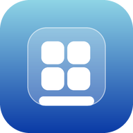
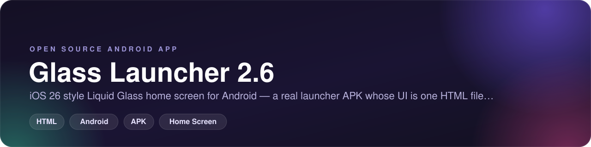

<div align="center">





<a href="https://github.com/technicalnihilist-lgtm/glass-launcher/stargazers"></a>&nbsp;<a href="https://github.com/technicalnihilist-lgtm/glass-launcher/network/members"></a>

<a href="https://github.com/technicalnihilist-lgtm/glass-launcher/releases/latest"></a>

<b>Support the work</b>

  

<sub>Donations aren't live yet — Paytm, UPI, PayPal and Buy&nbsp;Me&nbsp;a&nbsp;Coffee all show <b>coming soon</b>. Until then, a ⭐ star is the best support.</sub>

<a href="https://github.com/technicalnihilist-lgtm/glass-launcher/releases/latest"></a>  <a href="https://github.com/technicalnihilist-lgtm/glass-launcher/releases"></a>

</div>

---

## What changed in the page (8 lines, nothing else)

The design, icons, widgets, dock, colours, animations and gestures are untouched. The
page used to be a fixed 390×844 canvas scaled with `min(width/390, height/844)`, which
left black bands on tall screens and let the Search pill sit on top of the last row of
icons. Those are the only things that moved:

| Line | Before | After |
|---|---|---|
| `#track` height | `844px` | `100%` |
| `.page` height | `844px` | `100%` |
| `#sp` top | `682px` | `calc(100% - 162px)` |
| `#dock` top | `730px` | `calc(100% - 114px)` |
| `fit()` | `K = min(w/390, h/844)` | fills width, canvas height grows to the real screen |
| `ins()` | `844 - …` | `H - …` (zoom animation follows the real height) |
| `gridI()` | fixed 99 px row pitch | pitch passed in |
| `build()` | 16 apps page 1 / 24 after | rows and pitch computed from the space above the pill, and the page re-flows on resize |
| `#status` top | `0` | `var(--st)` — clears the notch / camera hole |
| `#sp`, `#dock` | fixed | `- var(--sb)` — clears the navigation bar |
| `setSafeArea()` | — | new hook: the shell reports the real insets, the page re-flows |

On a 390×844 screen the result is **pixel‑identical** to the original (verified: 0 differing
pixels out of 329,160). On taller screens the grid simply gains a row.

The native shell (`MainActivity.java`) only does what a web page cannot: read the installed
apps, hand them over through `setApps()`, launch a package when the page calls
`Android.launch(pkg)`, and map Back / Home / resume to `goBack()` / `goHome()` /
`onResumeL()`.

## Screen fitting (2.4) — the big one

The page runs edge to edge, and until 2.3 it knew nothing about the system bars. On any
phone the **dock sat behind the navigation bar** — completely hidden behind the three
buttons on 3-button navigation, and half under the gesture pill on gesture navigation.
That is the "does not fit my screen" problem.

Now the shell measures the real insets (navigation bar + display cutout, in dp) on every
window-inset change and calls `setSafeArea(top, bottom)`. The page lifts the dock, the
search pill and the status row by exactly that much and recomputes its rows. Verified at
0/24/48 dp navigation heights: dock clears the bar on all of them, the grid never collides
with the pill, and the wallpaper still runs full-bleed behind the bars.

## Crash and glitch fixes (2.2 → 2.4)

* **WebView renderer death** — heavy `backdrop-filter` on a low‑memory device can kill the
  WebView process on its own; `onRenderProcessGone()` now rebuilds it instead of taking the
  app down.
* **Icon memory blow‑up** — icon size now scales with app count (108 / 88 / 72 px) and
  `largeHeap` is on, so a phone with 250 apps cannot exhaust the WebView mid‑load.
* **Safe mode** — if the WebView cannot start at all, a plain native app list is shown so the
  phone always has a working launcher.
* **Stuck "opening…" overlay** — if an app disappears between listing and tapping, the shell
  calls `goHome()` instead of leaving the page on its overlay.
* **Search pill / last row overlap** — fixed by the `build()` change above.
* **Resize / fold / split‑screen** — the grid re‑flows, not just rescales.
* **Crash log** — uncaught exceptions are written to `files/last_crash.txt` before exit.
* **Portrait lock** — restored, as in the original manifest; this design is a phone‑portrait
  layout and landscape squashes it into a narrow strip.
* **Crash notice** — if the app crashed last time, the next start shows the exception name in
  a toast, so it can be reported instead of guessed at.

## Install

1. Grab the APK from the [v2.3 release](https://github.com/technicalnihilist-lgtm/glass-launcher/releases/latest)
   (or `adb install -r GlassLauncher.apk`).
2. Allow "Install unknown apps" when Android asks.
3. Press **Home** → **Glass Launcher** → **Always**.

To switch back: Settings → Apps → Default apps → Home app.

> The APK is signed with a self-signed key, so Play Protect may show one
> "unknown developer" prompt. That is normal for a sideloaded app.

> **Coming from 2.0?** Uninstall it first — the signing key changed in 2.1.
> 2.1 → 2.2 → 2.3 all install over each other normally.

## Known limits

* The weather widget ("Atlanta 54°") is static text in the page, not live weather.
* Tablets wider than the 390:844 aspect get side margins — the design is a phone canvas, and
  filling a tablet would need a real layout change rather than a scale change.

## Build it yourself

**Android Studio** — File → Open → this folder → Gradle sync → Run.

**Command line** (no Gradle, straight SDK build-tools):

```bash
export ANDROID_HOME=/path/to/android-sdk     # platforms;android-34 + build-tools;34.0.0
export JAVA_HOME=/path/to/jdk17
./build.sh                                   # → GlassLauncher.apk (signed, installable)
```

`build.sh` runs `aapt2 compile → aapt2 link → javac → d8 → zipalign → apksigner`.

## Project layout

```
app/src/main/assets/index.html          the UI (original + 8 lines)
app/src/main/java/com/glass/launcher/   WebView shell, app list, crash guards
app/src/main/AndroidManifest.xml        HOME intent filter, portrait, largeHeap
app/src/main/res/                       adaptive icon, theme, strings
docs/screenshots/                       the images above
build.sh                                CLI build
```

## Changelog

**2.6 — icons, from the device screenshot**
* **Icons rendered as dark silhouettes.** WebView's algorithmic darkening (on by default for
  targetSdk 33+ when the phone runs dark mode) dims images too. Now explicitly disabled:
  `setAlgorithmicDarkeningAllowed(false)` on API 33+, `setForceDark(FORCE_DARK_OFF)` below.
* **iOS 26 liquid glass on every icon** — a specular sweep from the top-left, a bright rim,
  an inner shadow at the bottom and a light glass base, so transparent icons sit on glass
  instead of on black.
* **Legacy icons with a transparent background** get an iOS-style light tile behind them
  (detected from the corner alpha of the rendered bitmap) instead of a dark glyph on black.
* **Long app names** ("Audio to Video Converter") wrapped to three lines and ran into the next
  row; labels are now clamped to two lines.
* **The dock could still be cut off** at the bottom of the screen: after scaling, the canvas is
  now measured against the visible viewport and pulled back if it overhangs.

**2.5 — bug sweep (17 automated interaction tests, all passing)**
* **The launcher rendered zoomed and cropped.** `#phone` was scaled with
  `translate(-50%,-50%) scale(K)`, which made the transformed box wider than the viewport.
  The mobile viewport then grew to fit that overflow, which made `K` bigger, which made the
  overflow bigger — a feedback loop. Measured: `innerWidth` drifted from 393 to 442–490, so
  the canvas was ~1.13× too big and cut off on both sides. Now `transform-origin:0 0` with an
  explicit `left/top`, so the box never exceeds the viewport. `innerWidth` stays exactly 393.
* **The app list was one 2–4 MB javascript string.** A phone with 120+ apps produced a string
  big enough that the WebView silently dropped it — the launcher then kept showing its
  built-in demo apps, and tapping them did nothing. The list is now 2.2 KB (names + packages)
  and the icons stream in afterwards in batches of six, ~20 ms apart.
* **Icons vanished after any re-layout** (resize, inset change) because they only existed in
  the DOM. They are now cached and re-applied on every rebuild.
* **Broken-image tiles** appeared when an icon was missing or invalid; they now fall back to
  a letter tile, and an `onerror` guard catches bad data.
* **`getAnimations()` does not exist on older Android WebViews** — opening any app threw and
  the app never launched. Guarded.
* **Opening an app with no icon threw a TypeError** (`el.querySelector('img').src`). Guarded.
* **Long-press on empty space flashed edit mode and cancelled it on release.** Fixed with a
  `lpFired` flag.
* **Demo apps flashed on launch** before the real list arrived; the demo grid and dock are now
  only built when the page runs outside the app.
* Bridge calls from the page (`launch`, `appInfo`) now hop to the UI thread, and the icon
  stream can no longer touch a destroyed WebView.

Verified at 360×800, 393×851, 393×917 (21:9), 412×915, 480×1040 and 800×1280 (tablet): no
overflow anywhere, canvas fills phones exactly and centres on tablets.

**2.4** — dock and status row now respect the navigation bar and the display cutout on every
device; crash notice toast. **2.3** — fills tall screens instead of letterboxing; Search pill no longer overlaps the
last row; grid re‑flows on resize; portrait lock restored.

**2.2** — `index.html` restored to the original. WebView renderer recovery, bounded icon
payload + `largeHeap`, safe‑mode fallback, stuck‑overlay recovery, crash log.

**2.1** — Glass app icon, centred widgets, action‑sheet tint, screenshots.

**2.0** — first public release.

---

---

## 🌍 Languages

<sub>Donations are <b>coming soon</b> in every language below — nothing to pay today, nothing to click.</sub>

<div align="center">

<sub><b>हिन्दी · বাংলা · मराठी · తెలుగు · தமிழ் · ગુજરાતી · ಕನ್ನಡ · മലയാളം · ਪੰਜਾਬੀ · ଓଡ଼ିଆ · অসমীয়া · اردو</b></sub>

</div>

<details>
<summary><b>🌍 Open the same message in 53 languages</b></summary>

**🇮🇳 Indian languages**

- **हिन्दी** (Hindi) — ☕ जल्द ही आ रहा है। · ⭐ अगर आपको यह ऐप और हमारा काम पसंद है, तो कृपया रिपॉजिटरी को स्टार दें और हमें फॉलो करें।
- **বাংলা** (Bengali) — ☕ খুব শিগগিরই আসছে। · ⭐ যদি আপনার এই অ্যাপ এবং আমাদের কাজ ভালো লাগে, তবে অনুগ্রহ করে রিপোজিটরিটিকে একটি স্টার দিন এবং আমাদের ফলো করুন।
- **मराठी** (Marathi) — ☕ लवकरच येत आहे. · ⭐ जर तुम्हाला हे ॲप आणि आमचं काम आवडलं असेल, तर कृपया रिपॉझिटरीला स्टार द्या आणि आम्हाला फॉलो करा.
- **తెలుగు** (Telugu) — ☕ త్వరలో రాబోతోంది. · ⭐ మీకు ఈ యాప్, మా పని నచ్చితే, దయచేసి రిపోజిటరీకి ఒక స్టార్ ఇచ్చి మమ్మల్ని ఫాలో అవ్వండి.
- **தமிழ்** (Tamil) — ☕ விரைவில் வருகிறது. · ⭐ உங்களுக்கு இந்த ஆப்பும் எங்க வேலையும் பிடிச்சிருந்தா, தயவுசெஞ்சு இந்த ரெபாசிட்டரிக்கு ஒரு ஸ்டார்…
- **ગુજરાતી** (Gujarati) — ☕ ટૂંક સમયમાં આવી રહ્યું છે. · ⭐ જો તમને આ એપ અને અમારું કામ ગમતું હોય, તો પ્લીઝ રિપોઝિટરીને સ્ટાર આપો અને અમને ફોલો કરો.
- **ಕನ್ನಡ** (Kannada) — ☕ ಶೀಘ್ರದಲ್ಲೇ ಬರುತ್ತಿದೆ. · ⭐ ನಿಮಗೆ ಈ ಆ್ಯಪ್ ಮತ್ತು ನಮ್ಮ ಕೆಲಸ ಇಷ್ಟವಾದರೆ, ದಯವಿಟ್ಟು ರೆಪೊಸಿಟರಿಗೆ ಸ್ಟಾರ್ ಕೊಡಿ ಮತ್ತು ನಮ್ಮನ್ನು ಫಾಲೋ ಮಾಡಿ.
- **മലയാളം** (Malayalam) — ☕ ഉടൻ വരുന്നു. · ⭐ നിങ്ങൾക്ക് ഈ ആപ്പും ഞങ്ങളുടെ പ്രവർത്തനവും ഇഷ്ടപ്പെട്ടെങ്കിൽ, ദയവായി റെപ്പോസിറ്ററിക്ക് ഒരു സ്റ്റാർ…
- **ਪੰਜਾਬੀ** (Punjabi) — ☕ ਜਲਦੀ ਆ ਰਿਹਾ ਹੈ। · ⭐ ਜੇ ਤੁਹਾਨੂੰ ਇਹ ਐਪ ਅਤੇ ਸਾਡਾ ਕੰਮ ਪਸੰਦ ਹੈ, ਤਾਂ ਕਿਰਪਾ ਕਰਕੇ ਰਿਪੋਜ਼ਟਰੀ ਨੂੰ ਸਟਾਰ ਦਿਓ ਅਤੇ ਸਾਨੂੰ ਫਾਲੋ ਕਰੋ।
- **ଓଡ଼ିଆ** (Odia) — ☕ ଖୁବ୍ ଶୀଘ୍ର ଆସୁଛି। · ⭐ ଯଦି ଆପଣଙ୍କୁ ଏହି ଆପ୍ ଏବଂ ଆମର କାମ ଭଲ ଲାଗୁଛି, ତେବେ ଦୟାକରି ରିପୋଜିଟୋରୀକୁ ଗୋଟିଏ ଷ୍ଟାର୍ ଦିଅନ୍ତୁ ଏବଂ ଆମକୁ ଫଲୋ କରନ୍ତୁ।
- **অসমীয়া** (Assamese) — ☕ অতি সোনকালেই আহি আছে। · ⭐ যদি আপুনি এই এপটো আৰু আমাৰ কাম ভাল পায়, তেন্তে অনুগ্ৰহ কৰি ৰিপজিটৰীটোক এটা ষ্টাৰ দিয়ক আৰু আমাক ফ'ল' কৰক।
- **اردو** (Urdu) — ☕ جلد آرہا ہے۔ · ⭐ اگر آپ کو یہ ایپ اور ہمارا کام پسند آئے تو براہ کرم ریپازٹری کو سٹار دیں اور ہمیں فالو کریں۔
- **संस्कृतम्** (Sanskrit) — ☕ शीघ्रमेव आगच्छति।
- **मैथिली** (Maithili) — ☕ जल्दिये आबि रहल अछि।
- **कोंकणी** (Konkani) — ☕ रोखडेंच येता.
- **کٲشُر** (Kashmiri) — ☕ جَلدی یِوان چھُ۔
- **سنڌي** (Sindhi) — ☕ जल्द अची रह्यो आहे।
- **डोगरी** (Dogri) — ☕ जल्दी आ करदा ऐ।
- **ꯃꯤꯇꯩ ꯂꯣꯟ** (Manipuri) — ☕ ꯑꯊꯨꯕꯥ ꯃꯇꯝꯗꯥ ꯂꯥꯛꯀꯅꯤ꯫
- **बर’** (Bodo) — ☕ थाबैनो फैगोन।
- **ᱥᱟᱱᱛᱟᱲᱤ** (Santali) — ☕ ᱞᱚᱜᱚᱱ ᱦᱤᱡᱩᱜ ᱠᱟᱱᱟ᱾
- **नेपाली** (Nepali) — ☕ छिट्टै आउँदैछ। · ⭐ यदि तपाईंलाई यो एप र हाम्रो काम मन पर्‍यो भने, कृपया रिपोजिटरीलाई स्टार दिनुहोस् र हामीलाई फलो गर्नुहोस्।

**🌍 World languages**

- **العربية** (Arabic) — ☕ قريبًا. · ⭐ إذا أعجبك هذا التطبيق وعملنا، فيرجى منح المستودع نجمة ومتابعتنا.
- **简体中文** (Chinese (Simplified)) — ☕ 即将推出。
- **繁體中文** (Chinese (Traditional)) — ☕ 即將推出。
- **Čeština** (Czech) — ☕ Již brzy.
- **Dansk** (Danish) — ☕ Kommer snart.
- **Nederlands** (Dutch) — ☕ Binnenkort beschikbaar. · ⭐ Vind je deze app en ons werk leuk?
- **Filipino** (Filipino) — ☕ Malapit na.
- **Suomi** (Finnish) — ☕ Tulossa pian.
- **Français** (French) — ☕ Bientôt disponible. · ⭐ Si cette application et notre travail vous plaisent, mettez une étoile au dépôt et suivez-nous.
- **Deutsch** (German) — ☕ Bald verfügbar. · ⭐ Wenn dir diese App und unsere Arbeit gefallen, gib dem Repository einen Stern und folge uns.
- **Ελληνικά** (Greek) — ☕ Έρχεται σύντομα.
- **עברית** (Hebrew) — ☕ בקרוב.
- **Magyar** (Hungarian) — ☕ Hamarosan.
- **Bahasa Indonesia** (Indonesian) — ☕ Segera hadir. · ⭐ Jika kamu suka aplikasi ini dan karya kami, beri bintang pada repositori ini dan ikuti kami.
- **Italiano** (Italian) — ☕ In arrivo.
- **日本語** (Japanese) — ☕ 近日公開。 · ⭐ このアプリと私たちの仕事が気に入ったら、リポジトリにスターを付けてフォローしてください。
- **한국어** (Korean) — ☕ 곧 공개됩니다. · ⭐ 이 앱과 저희 작업이 마음에 드신다면 저장소에 스타를 눌러 주시고 팔로우해 주세요.
- **Bahasa Melayu** (Malay) — ☕ Akan datang.
- **Norsk** (Norwegian) — ☕ Kommer snart.
- **فارسی** (Persian) — ☕ به‌زودی.
- **Polski** (Polish) — ☕ Wkrótce. · ⭐ Jeśli podoba Ci się ta aplikacja i nasza praca, daj repozytorium gwiazdkę i obserwuj nas.
- **Português** (Portuguese) — ☕ Em breve.
- **Română** (Romanian) — ☕ În curând.
- **Русский** (Russian) — ☕ Скоро. · ⭐ Если вам нравится это приложение и наша работа, поставьте звёздочку репозиторию и подпишитесь на нас.
- **Español** (Spanish) — ☕ Muy pronto. · ⭐ Si te gusta esta app y nuestro trabajo, dale una estrella al repositorio y síguenos.
- **Kiswahili** (Swahili) — ☕ Inakuja hivi karibuni.
- **Svenska** (Swedish) — ☕ Kommer snart.
- **ไทย** (Thai) — ☕ เร็ว ๆ นี้
- **Türkçe** (Turkish) — ☕ Çok yakında.
- **Українська** (Ukrainian) — ☕ Незабаром.
- **Tiếng Việt** (Vietnamese) — ☕ Sắp ra mắt. · ⭐ Nếu bạn thích ứng dụng này và công việc của chúng tôi, hãy tặng kho lưu trữ một ngôi sao và theo…

</details>

