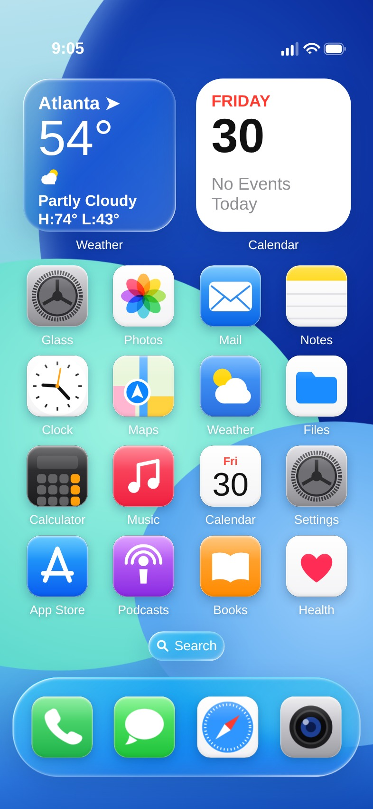
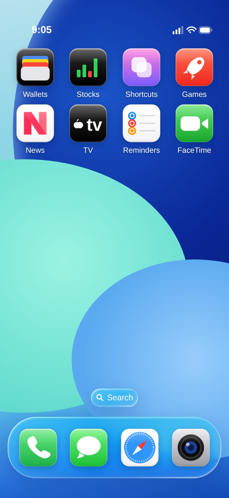
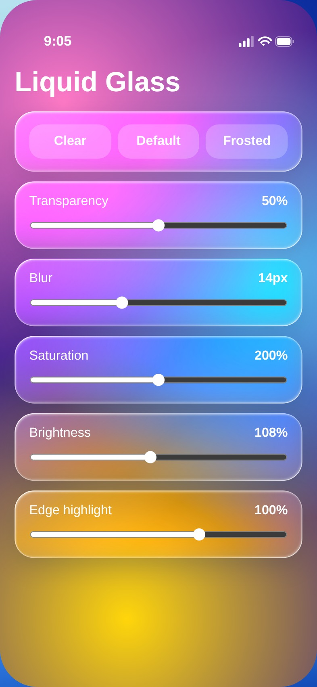

# Glass Launcher 2.5

An iOS‑style Liquid Glass home screen for Android — a real HOME app (launcher), not a
mockup. The UI is your `index.html`, with a handful of lines changed — every one of them a bug fix, no redesign.

[**⬇ Download the APK**](https://github.com/technicalnihilist-lgtm/glass-launcher/releases/download/v2.5/GlassLauncher.apk) · [latest release](https://github.com/technicalnihilist-lgtm/glass-launcher/releases/latest) · 69 KB · Android 7.0+ (API 24) · no permissions

| Home (21:9 phone) | Second page | Liquid Glass controls |
|:--:|:--:|:--:|
|  |  |  |

*(Rendered at 393×917 @2× — a tall 21:9 screen — fed through the same `setApps()` call the APK uses.)*

## What changed in the page (8 lines, nothing else)

The design, icons, widgets, dock, colours, animations and gestures are untouched. The
page used to be a fixed 390×844 canvas scaled with `min(width/390, height/844)`, which
left black bands on tall screens and let the Search pill sit on top of the last row of
icons. Those are the only things that moved:

| Line | Before | After |
|---|---|---|
| `#track` height | `844px` | `100%` |
| `.page` height | `844px` | `100%` |
| `#sp` top | `682px` | `calc(100% - 162px)` |
| `#dock` top | `730px` | `calc(100% - 114px)` |
| `fit()` | `K = min(w/390, h/844)` | fills width, canvas height grows to the real screen |
| `ins()` | `844 - …` | `H - …` (zoom animation follows the real height) |
| `gridI()` | fixed 99 px row pitch | pitch passed in |
| `build()` | 16 apps page 1 / 24 after | rows and pitch computed from the space above the pill, and the page re-flows on resize |
| `#status` top | `0` | `var(--st)` — clears the notch / camera hole |
| `#sp`, `#dock` | fixed | `- var(--sb)` — clears the navigation bar |
| `setSafeArea()` | — | new hook: the shell reports the real insets, the page re-flows |

On a 390×844 screen the result is **pixel‑identical** to the original (verified: 0 differing
pixels out of 329,160). On taller screens the grid simply gains a row.

The native shell (`MainActivity.java`) only does what a web page cannot: read the installed
apps, hand them over through `setApps()`, launch a package when the page calls
`Android.launch(pkg)`, and map Back / Home / resume to `goBack()` / `goHome()` /
`onResumeL()`.

## Screen fitting (2.4) — the big one

The page runs edge to edge, and until 2.3 it knew nothing about the system bars. On any
phone the **dock sat behind the navigation bar** — completely hidden behind the three
buttons on 3-button navigation, and half under the gesture pill on gesture navigation.
That is the "does not fit my screen" problem.

Now the shell measures the real insets (navigation bar + display cutout, in dp) on every
window-inset change and calls `setSafeArea(top, bottom)`. The page lifts the dock, the
search pill and the status row by exactly that much and recomputes its rows. Verified at
0/24/48 dp navigation heights: dock clears the bar on all of them, the grid never collides
with the pill, and the wallpaper still runs full-bleed behind the bars.

## Crash and glitch fixes (2.2 → 2.4)

* **WebView renderer death** — heavy `backdrop-filter` on a low‑memory device can kill the
  WebView process on its own; `onRenderProcessGone()` now rebuilds it instead of taking the
  app down.
* **Icon memory blow‑up** — icon size now scales with app count (108 / 88 / 72 px) and
  `largeHeap` is on, so a phone with 250 apps cannot exhaust the WebView mid‑load.
* **Safe mode** — if the WebView cannot start at all, a plain native app list is shown so the
  phone always has a working launcher.
* **Stuck "opening…" overlay** — if an app disappears between listing and tapping, the shell
  calls `goHome()` instead of leaving the page on its overlay.
* **Search pill / last row overlap** — fixed by the `build()` change above.
* **Resize / fold / split‑screen** — the grid re‑flows, not just rescales.
* **Crash log** — uncaught exceptions are written to `files/last_crash.txt` before exit.
* **Portrait lock** — restored, as in the original manifest; this design is a phone‑portrait
  layout and landscape squashes it into a narrow strip.
* **Crash notice** — if the app crashed last time, the next start shows the exception name in
  a toast, so it can be reported instead of guessed at.

## Install

1. Grab the APK from the [v2.3 release](https://github.com/technicalnihilist-lgtm/glass-launcher/releases/latest)
   (or `adb install -r GlassLauncher.apk`).
2. Allow "Install unknown apps" when Android asks.
3. Press **Home** → **Glass Launcher** → **Always**.

To switch back: Settings → Apps → Default apps → Home app.

> The APK is signed with a self-signed key, so Play Protect may show one
> "unknown developer" prompt. That is normal for a sideloaded app.

> **Coming from 2.0?** Uninstall it first — the signing key changed in 2.1.
> 2.1 → 2.2 → 2.3 all install over each other normally.

## Known limits

* The weather widget ("Atlanta 54°") is static text in the page, not live weather.
* Tablets wider than the 390:844 aspect get side margins — the design is a phone canvas, and
  filling a tablet would need a real layout change rather than a scale change.

## Build it yourself

**Android Studio** — File → Open → this folder → Gradle sync → Run.

**Command line** (no Gradle, straight SDK build-tools):

```bash
export ANDROID_HOME=/path/to/android-sdk     # platforms;android-34 + build-tools;34.0.0
export JAVA_HOME=/path/to/jdk17
./build.sh                                   # → GlassLauncher.apk (signed, installable)
```

`build.sh` runs `aapt2 compile → aapt2 link → javac → d8 → zipalign → apksigner`.

## Project layout

```
app/src/main/assets/index.html          the UI (original + 8 lines)
app/src/main/java/com/glass/launcher/   WebView shell, app list, crash guards
app/src/main/AndroidManifest.xml        HOME intent filter, portrait, largeHeap
app/src/main/res/                       adaptive icon, theme, strings
docs/screenshots/                       the images above
build.sh                                CLI build
```

## Changelog

**2.5 — bug sweep (17 automated interaction tests, all passing)**
* **The launcher rendered zoomed and cropped.** `#phone` was scaled with
  `translate(-50%,-50%) scale(K)`, which made the transformed box wider than the viewport.
  The mobile viewport then grew to fit that overflow, which made `K` bigger, which made the
  overflow bigger — a feedback loop. Measured: `innerWidth` drifted from 393 to 442–490, so
  the canvas was ~1.13× too big and cut off on both sides. Now `transform-origin:0 0` with an
  explicit `left/top`, so the box never exceeds the viewport. `innerWidth` stays exactly 393.
* **The app list was one 2–4 MB javascript string.** A phone with 120+ apps produced a string
  big enough that the WebView silently dropped it — the launcher then kept showing its
  built-in demo apps, and tapping them did nothing. The list is now 2.2 KB (names + packages)
  and the icons stream in afterwards in batches of six, ~20 ms apart.
* **Icons vanished after any re-layout** (resize, inset change) because they only existed in
  the DOM. They are now cached and re-applied on every rebuild.
* **Broken-image tiles** appeared when an icon was missing or invalid; they now fall back to
  a letter tile, and an `onerror` guard catches bad data.
* **`getAnimations()` does not exist on older Android WebViews** — opening any app threw and
  the app never launched. Guarded.
* **Opening an app with no icon threw a TypeError** (`el.querySelector('img').src`). Guarded.
* **Long-press on empty space flashed edit mode and cancelled it on release.** Fixed with a
  `lpFired` flag.
* **Demo apps flashed on launch** before the real list arrived; the demo grid and dock are now
  only built when the page runs outside the app.
* Bridge calls from the page (`launch`, `appInfo`) now hop to the UI thread, and the icon
  stream can no longer touch a destroyed WebView.

Verified at 360×800, 393×851, 393×917 (21:9), 412×915, 480×1040 and 800×1280 (tablet): no
overflow anywhere, canvas fills phones exactly and centres on tablets.

**2.4** — dock and status row now respect the navigation bar and the display cutout on every
device; crash notice toast. **2.3** — fills tall screens instead of letterboxing; Search pill no longer overlaps the
last row; grid re‑flows on resize; portrait lock restored.

**2.2** — `index.html` restored to the original. WebView renderer recovery, bounded icon
payload + `largeHeap`, safe‑mode fallback, stuck‑overlay recovery, crash log.

**2.1** — Glass app icon, centred widgets, action‑sheet tint, screenshots.

**2.0** — first public release.
