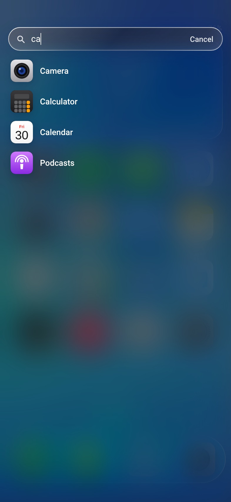
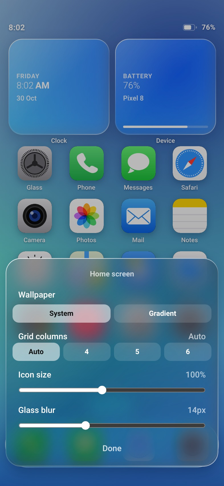
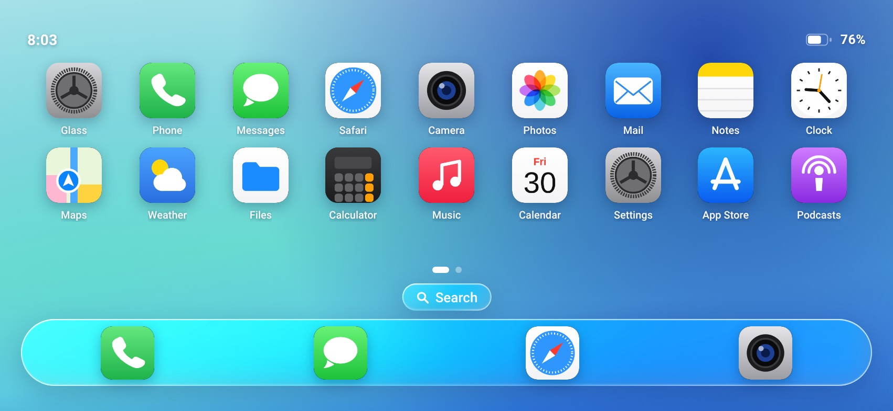

# Glass Launcher 2.1

An iOS‑style **Liquid Glass** home screen for Android — a real HOME app (launcher), not a
mockup. The whole UI is one HTML file inside a native WebView shell, and every
measurement it uses comes from the device, so it fits any phone, tablet or foldable.

[**Download the APK**](GlassLauncher.apk) · 69 KB · Android 7.0+ (API 24) · no permissions

| Home | Apps | Search |
|:--:|:--:|:--:|
|  |  |  |

| Long‑press to customise | Liquid Glass controls | Landscape |
|:--:|:--:|:--:|
|  |  |  |

## Install

1. Copy `GlassLauncher.apk` to the phone (or `adb install -r GlassLauncher.apk`).
2. Allow "Install unknown apps" when Android asks.
3. Press **Home** → choose **Glass Launcher** → **Always**.

To switch back: Settings → Apps → Default apps → Home app.

> The APK is signed with a self-signed key, so Play Protect may show one
> "unknown developer" prompt. That is normal for a sideloaded app.

## What "adapts to the system" actually means

Nothing here is pinned to one screen size. The old build scaled a fixed 390×844
canvas; this one measures the device:

* **Real insets** — window, display-cutout and navigation-bar insets are read in Java
  (`readInsets`) and drive the status row, dock, search field and every sheet. Notch,
  punch-hole and gesture-nav devices each get the right spacing.
* **Density-aware sizing** — WebView CSS pixels equal dp, so an icon is physically the
  same size on a 320 dp phone and an 800 dp tablet.
* **Auto grid** — columns = `clamp(floor((width − 2·pad) / 92), 4, 7)` in portrait and
  `clamp(… / 86, 6, 10)` in landscape. Rows come from the space actually left above the
  dock, so nothing ever overlaps or gets clipped. Widgets drop out automatically when
  there is no room (e.g. landscape), and come back in portrait.
* **Rotation, foldables, split-screen** — `configChanges` keeps the activity alive and the
  page re-lays-out on every resize, keeping your current page.
* **Real system data** — system wallpaper (`WallpaperManager`), battery level and charging
  state, clock, locale (app names sorted with a locale-aware `Collator`), device model and
  Android version shown in the widgets and the Glass app.
* **Real app list** — `PackageManager.queryIntentActivities`, icons rasterised at
  `density × 56 px`, refreshed live when apps are installed, removed or replaced.
* **Real navigation** — Back → `goBack()` (close app → close sheet → page 0 → wobble),
  Home → `goHome()`, edge-swipe back, long-press for app info.

## Interactions

| Gesture | Result |
|---|---|
| Swipe left / right | Change home page |
| Tap an icon | Launch the app (zooms out of the icon) |
| Long-press an icon | Open / App info sheet |
| Long-press empty space | Wallpaper, grid columns, icon size, glass blur |
| Tap **Search** | Filter and launch installed apps |
| Swipe from left/right edge | Back |
| Back key | Close app → close sheet → first page |

The **Glass** app (first icon) exposes the liquid-glass engine: presets (Clear / Default /
Frosted) plus transparency, blur, saturation, brightness and edge highlight. Preferences
persist in `localStorage` (`glass_launcher_v1`).

## Build it yourself

**Android Studio** — File → Open → this folder → Gradle sync → Run.

**Command line** (no Gradle, straight SDK build-tools):

```bash
export ANDROID_HOME=/path/to/android-sdk     # platforms;android-34 + build-tools;34.0.0
export JAVA_HOME=/path/to/jdk17
./build.sh                                   # → GlassLauncher.apk (signed, installable)
```

`build.sh` runs `aapt2 compile → aapt2 link → javac → d8 → zipalign → apksigner`.
It generates a local `keystore.jks` on first run (git-ignored).

## Project layout

```
app/src/main/assets/index.html          the entire UI (edit freely)
app/src/main/java/com/glass/launcher/   WebView shell + system bridge
app/src/main/AndroidManifest.xml        HOME intent filter, configChanges
app/src/main/res/                       adaptive icon, theme, strings
docs/screenshots/                       the images above
build.sh                                CLI build
```

## Changelog

**2.1**
* The built-in **Glass** settings app now has a proper icon instead of a letter avatar.
* Widget cards are vertically centred, so they look right at any widget height.
* Action sheet got a readability tint over busy wallpapers.
* Screenshots added.

**2.0** — first public release: adaptive layout, system insets, real wallpaper, battery,
locale-sorted app list, search, sheets, liquid-glass controls.
